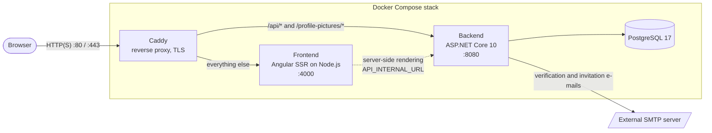
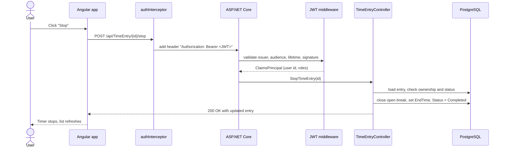
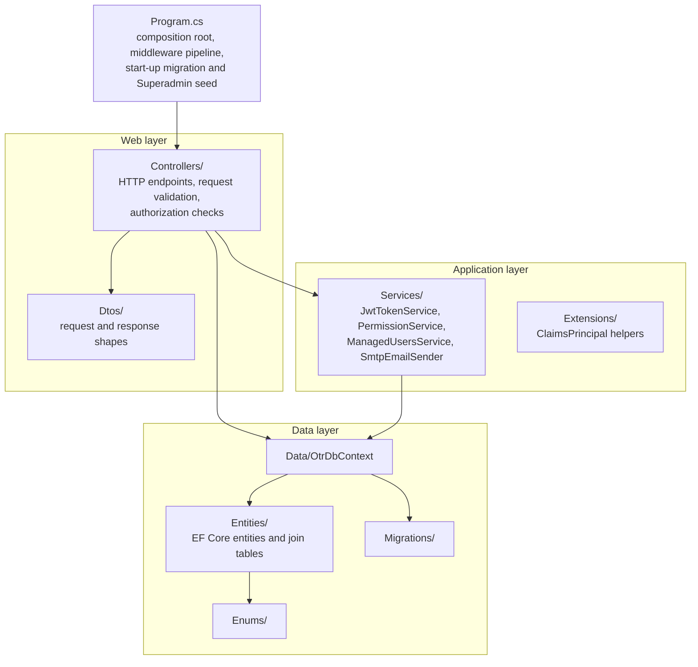
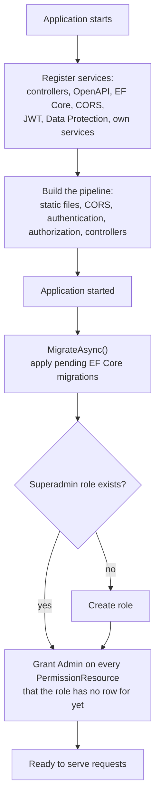
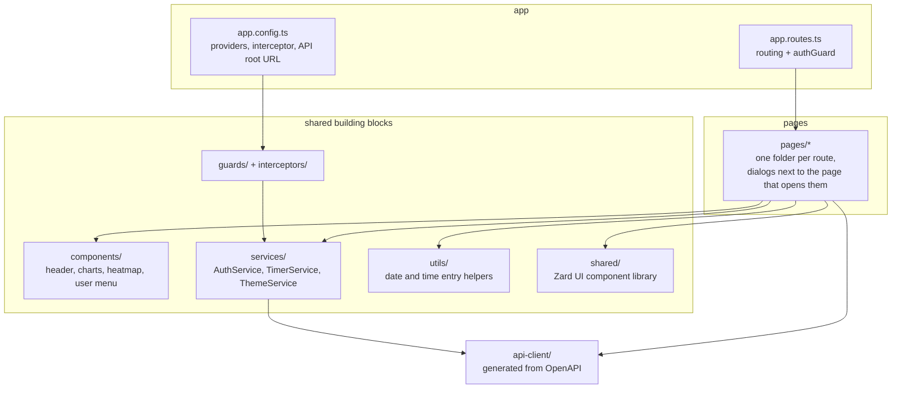
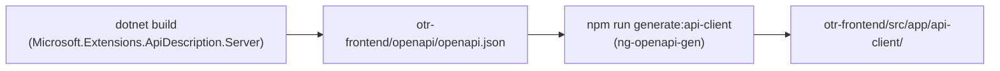

# Architecture

This document describes how OTR is built: the runtime components, how a request travels through them, and how the code in each component is organized.

- [System overview](#system-overview)
- [Request flow](#request-flow)
- [Backend structure](#backend-structure)
- [Frontend structure](#frontend-structure)
- [API client generation](#api-client-generation)
- [Design decisions](#design-decisions)

## System overview

OTR consists of four containers that are started together with Docker Compose. Only the reverse proxy is reachable from the outside.

| Component | Technology | Responsibility |
| --- | --- | --- |
| **Caddy** | Caddy 2 | Terminates TLS (automatic Let's Encrypt certificates if a domain is configured) and routes requests by path. |
| **Frontend** | Angular 21, Tailwind CSS 4, Zard UI | Single-page application, server-side rendered and prerendered by an Express server. |
| **Backend** | ASP.NET Core 10, EF Core 10 | REST API, authentication, authorization, business rules, e-mail delivery. |
| **PostgreSQL** | PostgreSQL 17 | Persistent storage. The schema is created and upgraded by EF Core migrations on backend start-up. |

The browser only ever talks to a single origin. In production Caddy serves the frontend and the API from the same host, so the frontend uses relative URLs and CORS is not needed. CORS is only enabled for `http://localhost:4200` to support local development.

## Request flow

The following diagram shows what happens when a logged-in user stops the running timer.

## Backend structure

The backend is a single ASP.NET Core project (`otr-backend/otr-backend`). It follows the classic controller / service / entity layering and keeps it intentionally small.

| Folder | Contents |
| --- | --- |
| `Controllers/` | One controller per resource. Routes follow `api/[controller]`. Controllers hold the request logic; there is deliberately no repository layer on top of EF Core. |
| `Services/` | Logic shared between controllers: token creation, permission lookup, resolving which users a manager is responsible for, sending e-mail. |
| `Entities/` | EF Core entities. The namespace is `otr_backend.Models`. `Entities/Mappings/` holds join tables with composite keys. |
| `Dtos/` | Request and response objects that must not expose the entity directly (for example passwords or aggregated views). |
| `Enums/` | Status values, permission resources and levels, rule types. |
| `Data/` | `OtrDbContext` with the few mappings that EF cannot infer from conventions. |
| `Migrations/` | Generated EF Core migrations. Applied automatically on start-up. |

### Start-up sequence

The migration and seeding step runs after `ApplicationStarted` instead of inline in `Program.cs`. The build-time OpenAPI generator executes `Program.cs` up to `app.Build()` without a database, so database work must not happen before that point.

## Frontend structure

The frontend lives in `otr-frontend/src/app` and uses standalone components, signals and the new control flow syntax.

| Folder | Contents |
| --- | --- |
| `pages/` | Routed screens. Each page owns its dialogs in a sub folder. |
| `components/` | Reusable, app-specific components. |
| `services/` | Application-wide state: the login session (`AuthService`), the running timer (`TimerService`) and the theme (`ThemeService`). |
| `utils/` | Pure helper functions for dates and time entries, shared by several pages. |
| `guards/`, `interceptors/` | Route protection and attaching the JWT to requests. |
| `shared/` | The [Zard UI](https://zardui.com) component library, copied into the project. Treat it as vendored code. |
| `api-client/` | Generated. Do not edit by hand. |

Session state is kept in signals. `AuthService` mirrors the token and user in `localStorage`; because the server cannot read `localStorage`, guards always see "logged out" during server-side rendering and `App` redirects back once the client has hydrated.

## API client generation

The TypeScript client is generated from the backend's OpenAPI document, so request and response types always match the server.

The workflow `.github/workflows/generate-api-client.yml` does this automatically whenever backend code is pushed to `master` and commits the result.

## Design decisions

- **Stateless authentication.** A signed JWT carries the user id and roles. There is no server-side session.
- **Permissions in the database, not in code.** Roles map to a level per resource; see [Authentication and permissions](authentication-and-permissions.md).
- **Migrations on start-up.** A fresh or upgraded deployment needs no manual database step.
- **Encrypted SMTP password.** The password is protected with ASP.NET Core Data Protection. The key ring is stored in a Docker volume (`backend-keys`), otherwise the stored password would become unreadable after a container is recreated.
- **First user becomes Superadmin.** This avoids a separate bootstrap step for new installations.
