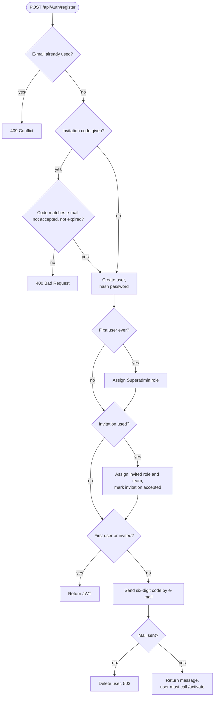
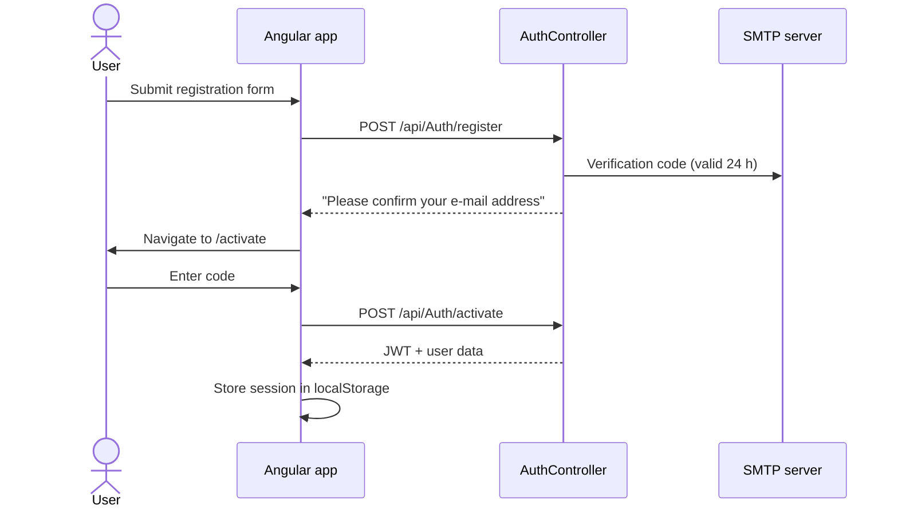
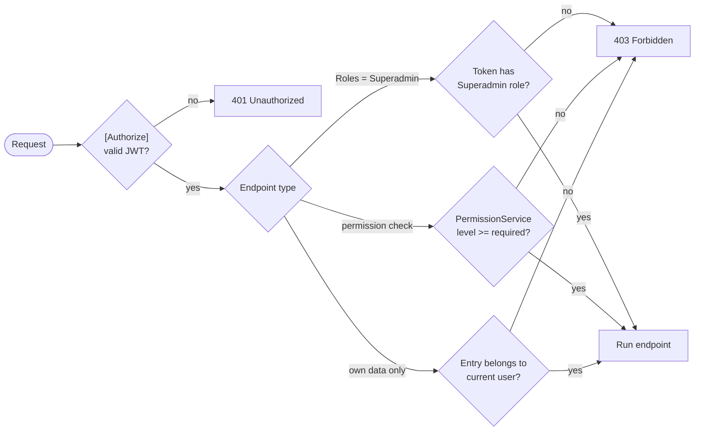
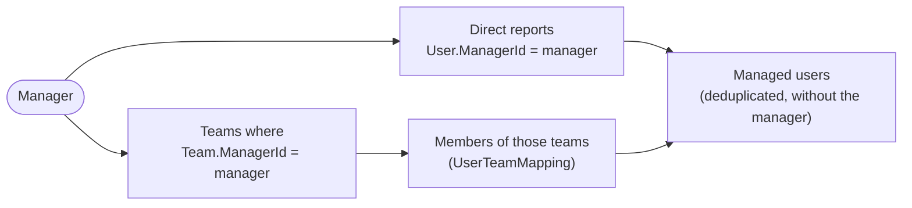

# Authentication and permissions

- [Registration and login](#registration-and-login)
- [JSON Web Tokens](#json-web-tokens)
- [Authorization model](#authorization-model)
- [Who sees whose data](#who-sees-whose-data)

## Registration and login

There are four ways to get an account.

| Way | Who | E-mail verification |
| --- | --- | --- |
| Self-registration of the **very first user** | anyone, once | skipped, the user becomes **Superadmin** |
| Registration with an **invitation code** | invited person | skipped, role/team/manager from the invitation are applied |
| Self-registration without invitation | anyone | required, six-digit code by e-mail |
| Created by an administrator | needs `Admin` on `Users` | skipped |

After registration without an invitation the user confirms the address:

`POST /api/Auth/resend-activation` always answers with the same message, so it cannot be used to find out which e-mail addresses are registered.

Passwords are hashed with ASP.NET Core Identity's `PasswordHasher<User>`. Login fails with the same message for an unknown e-mail address and a wrong password.

## JSON Web Tokens

On success the API returns a signed JWT (HMAC SHA-256). The Angular `authInterceptor` sends it as `Authorization: Bearer <token>` with every request.

| Claim | Content |
| --- | --- |
| `sub` / `nameidentifier` | database id of the user |
| `email` | e-mail address |
| `role` | one claim per assigned role name, e.g. `Superadmin` |

| Setting | Source | Notes |
| --- | --- | --- |
| `Jwt:Key` | configuration / `JWT_KEY` | Secret, at least 32 characters. Changing it logs everybody out. |
| `Jwt:Issuer` | configuration / `JWT_ISSUER` | Default `otr-backend` |
| `Jwt:Audience` | configuration / `JWT_AUDIENCE` | Default `otr-frontend` |
| Lifetime | `JwtTokenService.TokenLifetime` | 7 days. There is no refresh mechanism yet. |

Because role names are embedded in the token, a change of a user's roles only takes effect after the next login.

## Authorization model

Two mechanisms work side by side.

1. **Role checks.** Many administrative endpoints use `[Authorize(Roles = "Superadmin")]`.
2. **Permission checks.** Newer endpoints ask `PermissionService.HasPermissionAsync(userId, resource, minLevel)`.
3. **Ownership checks.** Time entries, breaks and correction requests can only be changed by their owner.

### Permission resources and levels

A role holds one **level** per **resource**. Levels are ordered, and a higher level includes the lower ones.

| Level | Meaning |
| --- | --- |
| `None` | no access (stored as a missing row) |
| `Read` | view |
| `Write` | view and modify |
| `Admin` | full control |

A user's effective level on a resource is the **highest level over all of their roles**.

Resources: `TimeEntries`, `Projects`, `Users`, `Rules`, `Roles`, `Teams`, `CorrectionRequests`, `Invitations`, `SmtpSettings`, `AppSettings`, `Clients`, `ProjectTasks`, `Tags`, `WorkSchedules`, `LeaveTypes`, `LeaveRequests`, `LeaveBalances`, `PublicHolidays`, `Notifications`, `AuditLogs`, `ProfilePicture`.

Currently the following endpoints are guarded by the permission system:

| Endpoint | Resource | Level |
| --- | --- | --- |
| `POST /api/User` | `Users` | `Admin` |
| `PUT /api/User/{id}` (for other users) | `Users` | `Write` |
| `GET /api/UserInvitation` | `Invitations` | `Read` |
| `POST /api/UserInvitation` | `Invitations` | `Write` |
| `POST /api/UserInvitation/{id}/archive` | `Invitations` | `Write` |
| `POST` / `DELETE /api/User/{id}/profile-picture` | `ProfilePicture` | `Write` |

All other resources are defined so that roles can be configured ahead of the features that will use them.

### The Superadmin role

On every start the backend makes sure that the role `Superadmin` exists and holds `Admin` on **every** resource. Rows that already exist are never touched, so a deliberately lowered level survives a restart; only resources that were added to the enum later are filled in.

## Who sees whose data

Reports and work schedules need to know which users a person may look at. `ManagedUsersService` resolves this:

| Caller | Sees |
| --- | --- |
| Normal user | own time entries and own work schedules |
| Manager | own data plus the data of all managed users |
| Superadmin | own data plus the data of everybody else |

A user who has **no manager** may set their own work schedule, because nobody else could.
