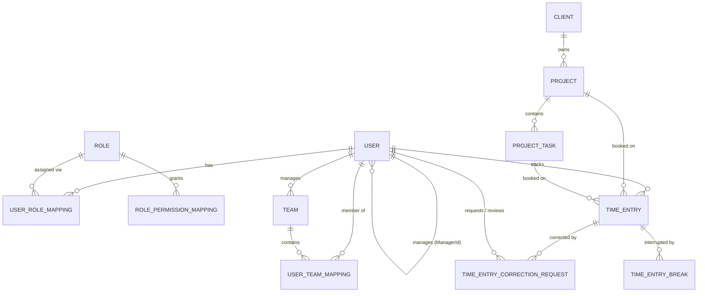
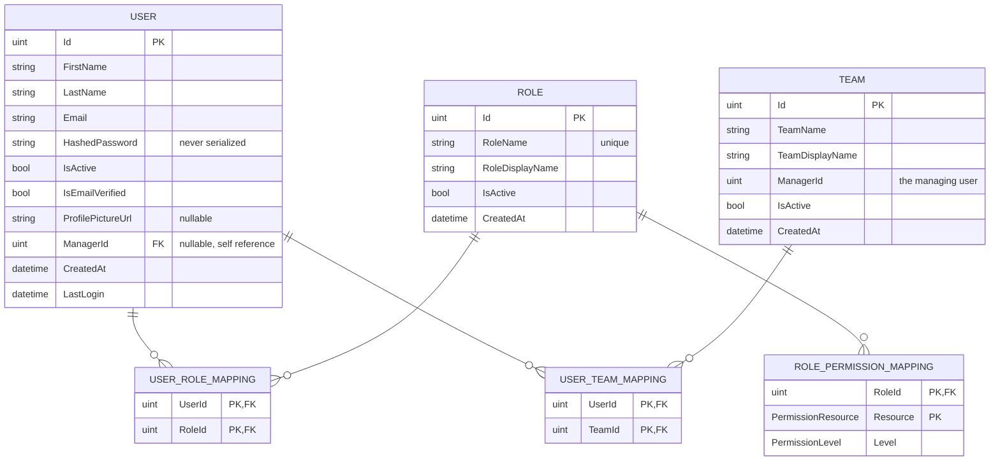
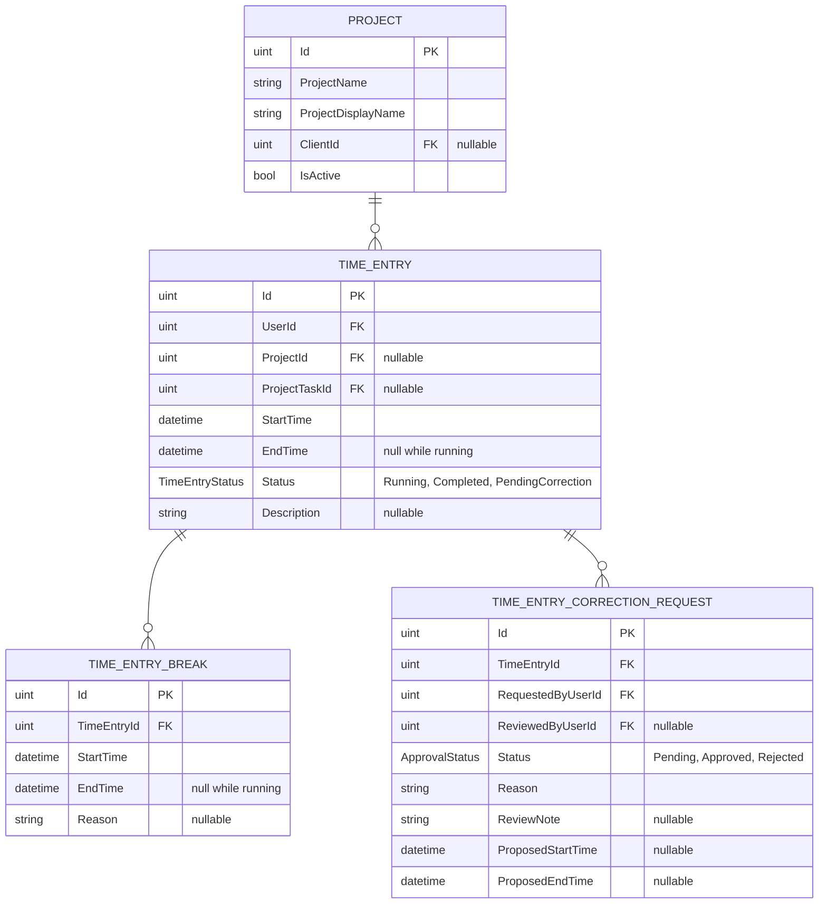
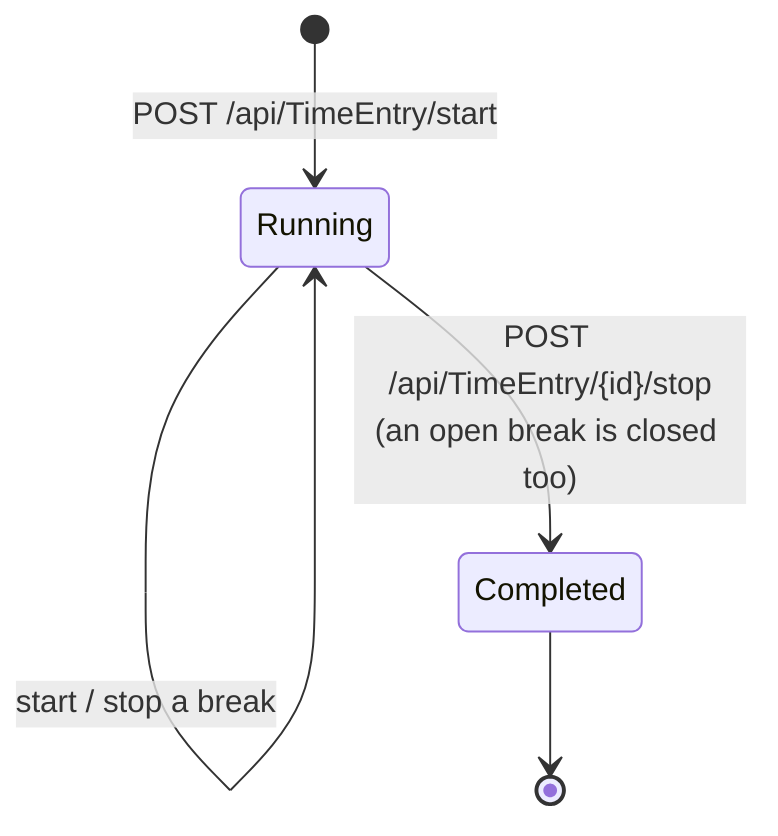
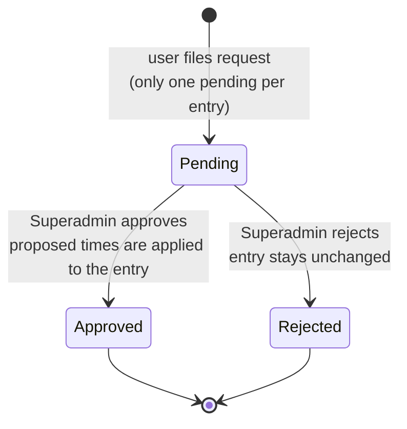

# Data model

OTR stores its data in PostgreSQL through Entity Framework Core. The entities live in `otr-backend/otr-backend/Entities`; the schema is defined by the migrations in `Migrations/` and applied automatically on start-up.

All primary keys are unsigned integers (`uint`). Timestamps are stored in UTC.

- [Overview](#overview)
- [Users, roles and teams](#users-roles-and-teams)
- [Time tracking](#time-tracking)
- [Onboarding and configuration](#onboarding-and-configuration)
- [Planned features](#planned-features)
- [Delete behavior](#delete-behavior)

## Overview

## Users, roles and teams

- A user can have several roles and belong to several teams (many-to-many through the mapping tables).
- `User.ManagerId` points at the user's direct manager. Together with `Team.ManagerId` it determines who a manager is responsible for; see `ManagedUsersService`.
- `ROLE_PERMISSION_MAPPING` has one row per role and resource. A missing row means no access.

## Time tracking

**Net worked time** of an entry is `EndTime - StartTime` minus the duration of all completed breaks.

### Life cycle of a time entry

Only one entry per user may be in the `Running` state, and only one break per entry may be open. The status `PendingCorrection` exists in the enum but is not set by the current code; pending corrections are tracked on the correction request instead.

### Life cycle of a correction request

## Onboarding and configuration

| Entity | Purpose |
| --- | --- |
| `EmailVerificationCode` | Six-digit code sent after self-registration, valid for 24 hours. |
| `UserInvitation` | Invitation for an e-mail address with a preassigned role, optional team and manager, valid for 7 days. |
| `SmtpSettings` | Single row with the mail server configuration. The password is stored encrypted. |
| `AppSettings` | Single row with the feature toggles (profile pictures, mandatory break reason). |
| `WorkSchedule` | Target hours per weekday for a user, valid from/to a date. Used for the target line in the reports. |

## Planned features

The following entities and API endpoints exist as scaffolding, but no user interface or business logic uses them yet:

`Client`, `ProjectTask`, `Tag` / `TimeEntryTagMapping`, `ProjectMember`, `Rule`, `LeaveType`, `LeaveRequest`, `LeaveBalance`, `PublicHoliday`, `Notification`, `RefreshToken`, `PasswordResetToken` and `TimeEntryAuditLog`.

Their permission resources are already part of the permission model so that roles can be prepared in advance.

## Delete behavior

Foreign keys that point at a user use `DeleteBehavior.Restrict`. A user with time entries, audit log entries, correction requests, leave requests or direct reports therefore cannot be deleted by accident. Deactivate the account instead (`User.IsActive = false`).
