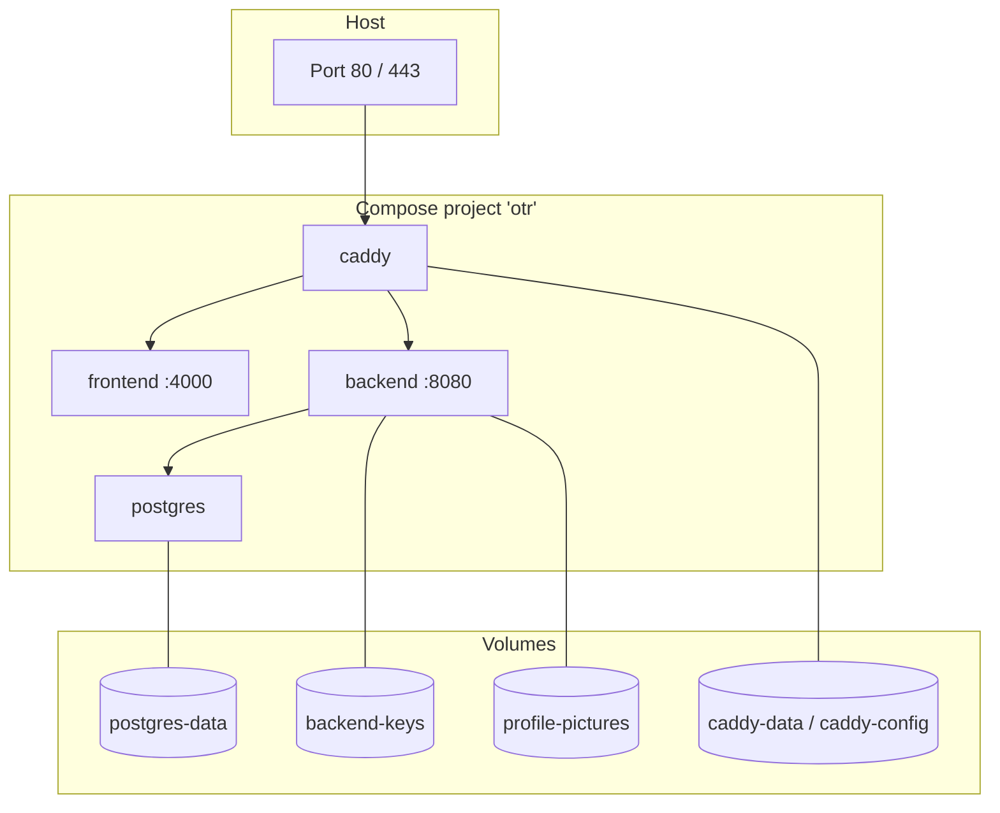

# Deployment

OTR is delivered as Docker images and a Docker Compose file. This document covers installation, configuration, updates and backups.

- [Installing](#installing)
- [Configuration](#configuration)
- [Services and volumes](#services-and-volumes)
- [Updating](#updating)
- [Backup and restore](#backup-and-restore)
- [Building from source](#building-from-source)
- [Hardening checklist](#hardening-checklist)

## Installing

1. Download `docker-compose.yml` and `.env.example` from the [latest release](../../../releases/latest). If you build from a checkout, they are in the `deploy/` directory (the example file is `deploy/.env.example`).
2. Copy the example and fill in your values:
   ```bash
   cp .env.example .env
   ```
3. Start the stack:
   ```bash
   docker compose up -d
   ```
4. Open the address in a browser and register. **The first person to register becomes Superadmin**, so do this right away.

Database migrations run automatically when the backend starts.

## Configuration

All settings are environment variables in `.env`.

| Variable | Default | Description |
| --- | --- | --- |
| `POSTGRES_DB` | – | Database name |
| `POSTGRES_USER` | – | Database user |
| `POSTGRES_PASSWORD` | – | Database password. Use a strong value. |
| `JWT_KEY` | – | Secret used to sign tokens. Generate one with `openssl rand -base64 48`. Changing it logs all users out. |
| `JWT_ISSUER` | `otr-backend` | Token issuer |
| `JWT_AUDIENCE` | `otr-frontend` | Token audience |
| `DOMAIN` | `http://localhost` | Leave as is for plain HTTP on localhost. For HTTPS use your domain without scheme (e.g. `otr.example.com`) and point its DNS record at the server; Caddy then obtains a Let's Encrypt certificate automatically. Ports 80 and 443 must be reachable. |
| `OTR_VERSION` | `latest` | Image tag, e.g. `v1.4.0`. Pin it for reproducible deployments. |

Mail settings (SMTP) are not environment variables; a Superadmin enters them in the application under *Settings → SMTP*.

## Services and volumes



| Volume | Content | Loss means |
| --- | --- | --- |
| `postgres-data` | The database | All data is gone. |
| `backend-keys` | Data Protection key ring | The stored SMTP password can no longer be decrypted; enter it again. |
| `profile-pictures` | Uploaded profile pictures | Pictures are gone. |
| `caddy-data`, `caddy-config` | TLS certificates and Caddy state | Certificates are requested again. |

The backend waits for the database health check, and Caddy waits for backend and frontend.

## Updating

```bash
# in the directory with docker-compose.yml and .env
# optionally set OTR_VERSION=vX.Y.Z in .env first
docker compose pull
docker compose up -d
```

Pending migrations are applied on start-up. Make a [backup](#backup-and-restore) before upgrading across several versions.

## Backup and restore

**Database**

```bash
# backup
docker compose exec -T postgres sh -c 'pg_dump -U "$POSTGRES_USER" "$POSTGRES_DB"' > otr-backup.sql

# restore into an empty database
docker compose exec -T postgres sh -c 'psql -U "$POSTGRES_USER" "$POSTGRES_DB"' < otr-backup.sql
```

**Volumes** `backend-keys` and `profile-pictures` should be backed up together with the database, for example with `docker run --rm -v otr_backend-keys:/data -v "$PWD":/backup alpine tar czf /backup/keys.tgz -C /data .` (the volume name is prefixed with the project name `otr`).

## Building from source

The compose file contains `build:` sections, so you can build the images yourself from a checkout:

```bash
cd deploy
cp .env.example .env     # edit
docker compose up -d --build
```

## Hardening checklist

- [ ] Strong, unique `POSTGRES_PASSWORD` and `JWT_KEY`
- [ ] `DOMAIN` set to a real domain so traffic is encrypted
- [ ] First account registered immediately after the first start
- [ ] SMTP configured, so users can verify their e-mail address
- [ ] Regular backups of the database and the `backend-keys` volume
- [ ] The PostgreSQL port is **not** published (it is not in the provided compose file; keep it that way)
- [ ] Images pinned with `OTR_VERSION` and updated regularly
