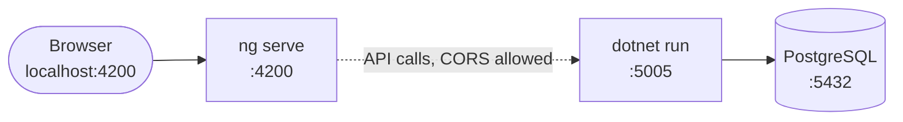
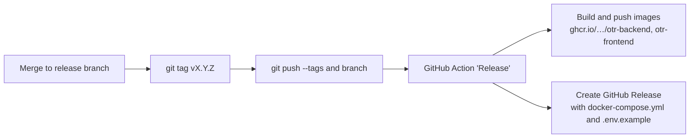

# Development guide

How to run OTR locally, how the code is organized, and the conventions used in it.

- [Prerequisites](#prerequisites)
- [Running locally](#running-locally)
- [Useful commands](#useful-commands)
- [Working with the database](#working-with-the-database)
- [Changing the API](#changing-the-api)
- [Code conventions](#code-conventions)
- [Releases](#releases)
- [Troubleshooting](#troubleshooting)

## Prerequisites

| Tool | Version | Purpose |
| --- | --- | --- |
| .NET SDK | 10 | Backend. On Arch Linux you also need the `aspnet-targeting-pack` package. |
| Node.js | 22 or newer | Frontend |
| npm | 11 (see `packageManager` in `package.json`) | Frontend dependencies |
| PostgreSQL | 17 | Database. Docker is the easiest way to get one. |
| Docker | optional | Database container, or the complete stack |

## Running locally



**1. Database**

```bash
docker run -d --name otr-pg \
  -e POSTGRES_DB=otr -e POSTGRES_USER=otr -e POSTGRES_PASSWORD=otr \
  -p 5432:5432 postgres:17-alpine
```

**2. Backend**

```bash
cd otr-backend/otr-backend
cp appsettings.Development.json.example appsettings.Development.json   # see below if the example is missing
dotnet restore
dotnet run            # http://localhost:5005, API docs at /scalar
```

`appsettings.Development.json` is ignored by git and has to contain:

```json
{
  "ConnectionStrings": {
    "Default": "Host=localhost;Database=otr;Username=otr;Password=otr"
  },
  "Jwt": {
    "Issuer": "otr-backend",
    "Audience": "otr-frontend",
    "Key": "a-long-random-secret-with-at-least-32-characters"
  }
}
```

The database schema is created automatically on the first start.

**3. Frontend**

```bash
cd otr-frontend
npm install           # or: npm ci
npm start             # http://localhost:4200
```

In development the frontend talks to `http://localhost:5005` (`src/app/api-root-url.ts`). The production build swaps this file for `api-root-url.prod.ts`, which uses a relative URL behind the reverse proxy.

Register the first account in the browser; it automatically becomes Superadmin.

**E-mail in development.** Verification and invitation e-mails need an SMTP server configured under *Settings → SMTP*. For local work you can skip this: the first user needs no verification, invitations can be created with "send e-mail" switched off, and administrators can create users directly.

## Useful commands

| Command | Directory | Purpose |
| --- | --- | --- |
| `dotnet run` | `otr-backend/otr-backend` | Start the API |
| `dotnet build` | `otr-backend/otr-backend` | Compile and regenerate `openapi/openapi.json` |
| `npm start` | `otr-frontend` | Dev server with live reload |
| `npm run build` | `otr-frontend` | Production build (browser + SSR) |
| `npm test` | `otr-frontend` | Unit tests |
| `npm run generate:api-client` | `otr-frontend` | Regenerate `src/app/api-client` |
| `docker compose up -d --build` | `deploy` | Build and run the whole stack |

## Working with the database

Migrations are applied automatically on start-up. To change the schema:

```bash
cd otr-backend/otr-backend
dotnet ef migrations add DescribeYourChange
dotnet run           # applies it
```

Install the tool once with `dotnet tool install --global dotnet-ef` if it is missing. Commit the generated files in `Migrations/`.

To start over with an empty database, remove the Postgres container (or its volume) and start the backend again.

## Changing the API

The Angular API client is generated, never edited by hand.

1. Change controllers, DTOs or entities in the backend.
2. `dotnet build` – this writes `otr-frontend/openapi/openapi.json`.
3. `npm run generate:api-client` in `otr-frontend`.
4. Commit both the OpenAPI file and the regenerated client.

On `master` the GitHub workflow *Generate API Client* does steps 2–4 automatically for backend changes.

## Code conventions

### General

- **Explicit types.** Declare the type of fields, parameters and return values. Use `var` / implicit inference only where the type is evident from the right-hand side and adds nothing (e.g. `inject(Service)`).
- **Meaningful names.** Spell words out (`managedUserIds`, not `ids`). Booleans read as questions (`isActive`, `hasOpenBreak`). Async methods in C# end in `Async` when they are not endpoints.
- **Comments explain why.** Every public type and member has a documentation comment (C# XML docs, TSDoc in TypeScript). Inline comments explain non-obvious decisions, not what the next line does.
- **No magic numbers.** Give constants a name (`TokenLifetime`, `MaxProfilePictureBytes`, `TIME_ENTRY_STATUS_RUNNING`).
- **Do not duplicate helpers.** Shared date and time-entry logic lives in `otr-frontend/src/app/utils`.
- **Language.** Code, comments and documentation are English. The user interface and the error messages returned by the API are German.

### Backend

- Controllers are thin: validate input, check authorization, talk to `OtrDbContext` (or a service), return an `ActionResult`.
- Every controller except `AuthController` carries `[Authorize]`. Use `[Authorize(Roles = "Superadmin")]` for administrator-only actions, or `PermissionService` for permission-based checks.
- Take the current user from the token via `User.GetUserId()`; never trust a user id sent by the client.
- Do not return entities that contain secrets. `User.HashedPassword` is `[JsonIgnore]`; use DTOs for everything else that needs shaping.
- Use `DateTime.UtcNow` for all timestamps.
- Nullable reference types are enabled. Initialize non-nullable strings with `string.Empty`.

### Frontend

- Standalone components that keep state in signals (`signal`, `computed`); services are `providedIn: 'root'`.
- Components inject dependencies with `inject()` and declare them `private readonly`.
- Template-bound members are `protected`.
- Network access goes through the generated services in `@/api-client`, wrapped in `try/catch` with a user-facing error signal.
- Dialogs are opened with `ZardDialogService`; the dialog component receives its input via `zData`.
- Do not edit `src/app/api-client` or `src/app/shared` by hand.

## Releases

Releases are cut from the `release` branch:



The workflow fails if the pushed commit has no version tag.

## Troubleshooting

| Symptom | Cause and fix |
| --- | --- |
| `NETSDK1226: Daten zum Löschen von Paketen wurden nicht gefunden … Microsoft.AspNetCore.App` | The ASP.NET Core targeting pack is missing. On Arch: `sudo pacman -S aspnet-targeting-pack`. Do not set `AllowMissingPrunePackageData`. |
| Backend crashes on start with a connection error | PostgreSQL is not running or the connection string in `appsettings.Development.json` is wrong. |
| `Jwt:Key` is null / `ArgumentNullException` in `Program.cs` | `appsettings.Development.json` is missing the `Jwt` section. |
| Browser shows CORS errors | The frontend must run on `http://localhost:4200`; other origins are not allowed. |
| Registration says the e-mail could not be sent | SMTP is not configured. Register as the very first user, or ask a Superadmin to create your account. |
| Stored SMTP password stopped working after a redeploy | The Data Protection key ring was lost. Mount the `keys` directory on a persistent volume (`backend-keys` in the compose file) and re-enter the password. |
